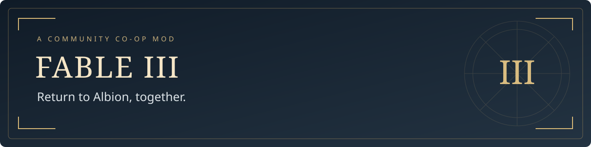

<p align="center">
  
</p>

<p align="center"><strong>Two players. Your saves. One Albion.</strong><br>
Friends, invitations, and online co-op for the supported PC version of Fable III.</p>

<p align="center"><strong>v2.5.1</strong> · Windows · Two-player co-op · Powered by XLiveLessNess</p>

<p align="center">
  <a href="https://github.com/LunalFresh/Fable3-Coop/releases/tag/v2.5.1"><strong>Download v2.5.1</strong></a> ·
  <a href="#installation">Install</a> ·
  <a href="#play-together">Play together</a> ·
  <a href="docs/NETWORKING.md">Networking</a> ·
  <a href="docs/TROUBLESHOOTING.md">Troubleshooting</a> ·
  <a href="BUILDING.md">Build from source</a>
</p>

---

## Return to Albion, together

Fable III Co-op brings two-player online co-op, saved friends, and invitations to the supported PC version of Fable III. Open the Friends and Invitations menu through the Sanctuary, connect with your friend, and join each other's worlds using a menu styled to fit the game.

## Features

| Feature | What you can do |
| :--- | :--- |
| **Two-player co-op** | Join a friend's world, play together, leave, and reconnect. Either player can host. |
| **Saved friends** | Send, accept, decline, or cancel friend requests. Accepted friendships stay saved between launches. Remove or block entries when needed. |
| **Presence and invitations** | See when friends are online and joinable, join directly, or send and accept game invitations. Incoming requests and invitations show notifications. |
| **Session controls** | Leave a session or remove the connected guest as host. Kicking uses a confirmation dialog. |
| **Controller support** | Navigate Friends and Invitations with an XInput controller using D-pad/left stick and A/B. Visible focus and button prompts show the selected control. |
| **Keyboard and mouse** | Use the menu with keyboard or mouse, including text entry for new names and IPv4 addresses. |
| **Input handling** | Controller input stays inside the open panel. Held-button protection and focus/reconnect recovery prevent accidental actions when returning to the menu or game. |
| **Local and remote play** | Connect across a local network or separate networks using reachable IPv4 addresses over UDP. |
| **Reversible installation** | Install with checksum verification and backups while preserving existing friends, profiles, settings, and saves. |
| **Setup helpers** | Configure an optional per-peer Windows firewall rule, import an existing save profile without overwriting its original, or restore a previous installation. |

## Requirements

- Each player needs a working Fable III installation, matching game content/DLC, and the same mod version.
- Supported executable: **Fable3.exe 1.1.1.3 / Patch 2**, with the exact checksum below.
- Tested on Windows 11. Setup uses Windows PowerShell 5.1. The packaged Opus build enables AVX2; CPUs without AVX2 are unverified.
- Each PC must be reachable by the other over **IPv4, UDP 39000–39001**. See [network setup](docs/NETWORKING.md).

<details>
<summary><strong>Supported executable checksum</strong></summary>

```text
AAC98798E77CA32282D663AF54FC185C3B5256B5317ED8568D7F12A0EF42DA42
```

Use `Get-FileHash .\Fable3.exe -Algorithm SHA256` in PowerShell to compare your file. Matching the executable does not check every game-data or DLC file.

</details>

## Installation

1. Download **[Fable3-Coop-v2.5.1.zip](https://github.com/LunalFresh/Fable3-Coop/releases/download/v2.5.1/Fable3-Coop-v2.5.1.zip)** from the [release page](https://github.com/LunalFresh/Fable3-Coop/releases/tag/v2.5.1). Extract the **entire ZIP** into a separate folder, such as Downloads. The package contains the ready-to-use mod, installer, and matching source; no build is required.
2. Close Fable III and its launcher. Run **Setup.cmd** from the extracted folder.
3. Enter the folder containing **Fable3.exe**. For a fresh installation, choose a player name different from your friend's. Existing profiles and settings are preserved.
4. If peer access is not already configured, follow the [network setup](docs/NETWORKING.md).
5. Launch **Start-Fable3-LAN.bat** from your game folder, then click **Play** in the original launcher.

Keep your player name's spelling and capitalization: it determines your local save identity. Setup preserves saves and does not include or modify game executables, activation files, DLC, or controller drivers. See [installation, save import, and uninstall](docs/INSTALLATION.md) for details.

To install over an existing version, close the game and run the new package's Setup.cmd against the same game folder. Keep the backup path printed by setup. You do not need to remove your friends or create a new profile.

## Play together

1. Both players launch the game and load their saves.
2. Open **Friends and Invitations** through the Sanctuary. One player enters the other's reachable **IPv4 address** and sends a **friend request**. A name is optional; a name alone cannot locate another PC.
3. The other player accepts the request. They do **not** need to add the sender's address manually.
4. Select a joinable friend and choose **Join**, or send a game **Invite** and accept it on the other PC.

Returning to the main menu briefly is part of joining; a successful join continues into the host's world. The host can use **Kick player** for the connected guest.

Declined requests remain labeled **Request declined** on the sender's side until removed or replaced with a new request. See [request states and connection help](docs/TROUBLESHOOTING.md).

## Controls

| Input | Action |
| :--- | :--- |
| **D-pad / left stick** | Move through friends, pages, and available menu actions. |
| **A** | Select a friend, then activate the highlighted action. |
| **B** | Return to the friends list; from the list, close the panel. Cancel a kick confirmation. |
| **Mouse / keyboard** | Select menu items and enter new names or addresses. |
| **F6** | Open an incoming request or invitation. |
| **Esc** | Close the panel. |
| **Home** | Open the XLLN guide. |

Controller navigation uses XInput with Xbox-style prompts. Release controls when opening or closing the panel. Kick confirmation defaults to Cancel. After Alt+Tab or reconnecting a controller, release the controls before continuing. See the [controller guide](docs/CONTROLS.md).

## Supported play

The mod supports **two-player, peer-hosted co-op**. Both games need to be running and reachable to exchange requests and invitations. Internet routing and firewall setup remain the players' responsibility; the mod does not provide central matchmaking, a public player directory, a relay, or a dedicated server.

Saved friend entries use one address per entry. New names and addresses use keyboard typing.

Gameplay validation covers co-op with either player hosting, the friend-request lifecycle, invitations, leaving/kicking/rejoining, and controller menu behavior. Automated runtime and installer/rollback checks also passed. Exact build provenance and test coverage are recorded in [VALIDATION.md](VALIDATION.md).

## Support

When reporting an issue, include the mod version, executable checksum, Windows version, which player was hosting, and the exact action/result. Say whether the peers were on the same or separate networks. Include only the relevant log excerpt, with personal names and addresses removed. Please do not upload saves, game files, or your entire game folder.

See the [changelog](CHANGELOG.md) for version history and [releases](https://github.com/LunalFresh/Fable3-Coop/releases) for downloads.

## Credits & source

Built on **GlitchyScripts' XLiveLessNess and XLLN Modules**, with Fable III integration, the Sanctuary-style friends menu, and the peer friend-request workflow. Matching modified source is included under [source/](source/); build instructions are in [BUILDING.md](BUILDING.md).

The runtime projects retain their **LGPL-2.1** licenses; installer scripts use **MIT**. See [license overview](LICENSE.md) and [third-party notices](THIRD-PARTY-NOTICES.md) for component details. This is an independent community project, unaffiliated with Microsoft or Lionhead Studios.
